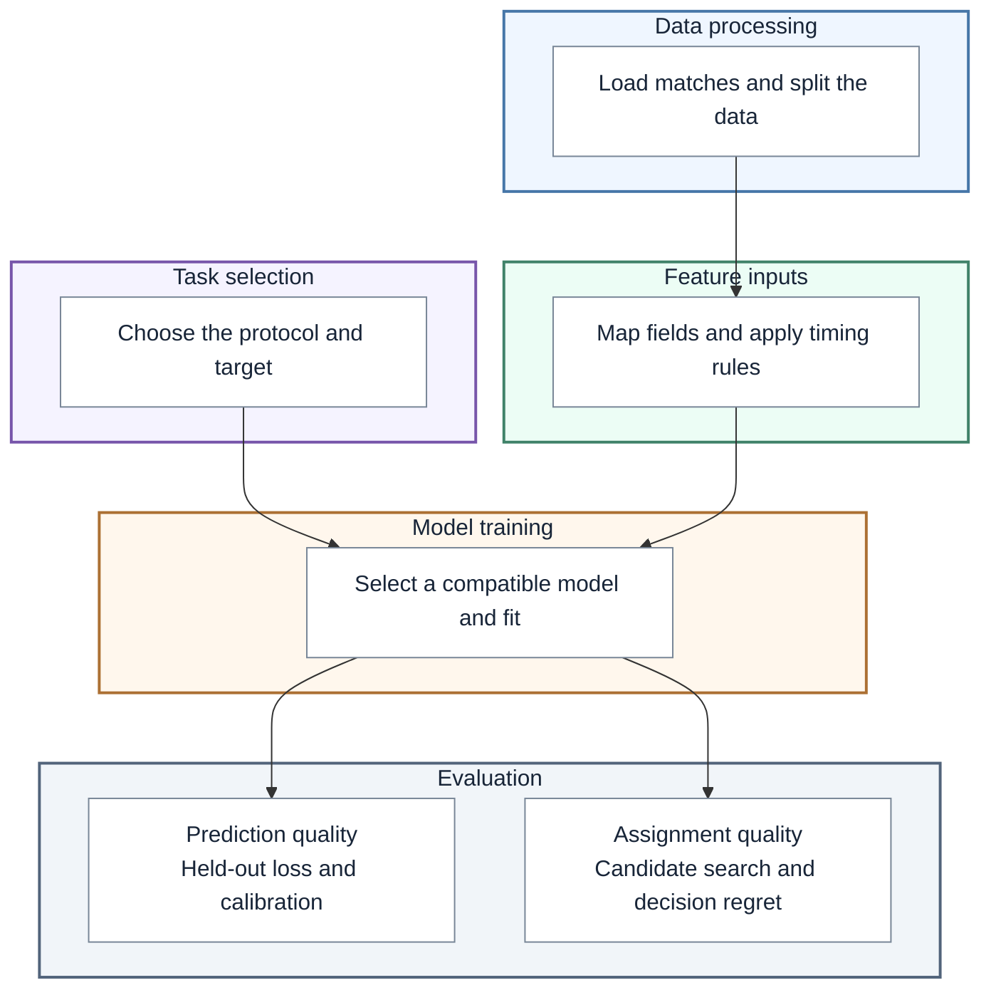

# Shuach · 耍起


Machine learning for balanced multiplayer matchmaking.

[Documentation](https://fogofwarai.github.io/shuach/) · [Search the Python API](https://fogofwarai.github.io/shuach/reference/)

[中文](README.zh-CN.md) · [Getting started](docs/getting-started.md) · [Python API](docs/api.md) · [Command reference](docs/cli.md)

Given a lobby, which teams should play each other? Shuach lets you score possible lineups, keep parties together, fill role slots, and compare feasible assignments. You can train outcome predictors on historical games, replay player ratings in time order, and measure the quality of assignment decisions on synthetic lobbies with a known outcome mechanism.

## Framework



Benchmark configurations select data and models supported by the protocol, which determines the evaluation metrics. For schema-based models, a profile selects the features and prediction target. Custom data needs a mapping from source fields to those inputs.

## Run your first match

From the repository root, create and activate a Python 3.10+ virtual environment. On Windows PowerShell use `.\.venv\Scripts\Activate.ps1`; on macOS or Linux use `source .venv/bin/activate` after creating the environment.

```sh
python -m venv .venv
# Activate the environment before continuing.
python -m pip install -e .
python examples/constrained_assignment.py
```

The example prints a feasible team assignment and role slots. It runs on CPU with generated players. The project originated as GameMatch. The Python import and CLI are both named `gamematch`, and the distribution is `gamematch-research`. **PyTorch is optional**: the base install runs the catalog, feature contracts and CPU assignment examples without downloading CUDA wheels.

Inspect an executable input/output contract, or solve a lobby too large to enumerate, without any training dependencies:

```sh
gamematch feature-schema --profile overwatch-history
gamematch lobby-approx --players 20 --time-budget 1
```

See [unified feature contracts](docs/feature-schema.md) for declaring new modalities, scopes and output heads, and [Supplying inputs](docs/inputs.md) for the exact arrays each declaration expects. A declared schema can be turned into a trainable model directly:

```sh
python -m pip install -e '.[neural]'
python examples/schema_model.py --profile hero-roster --steps 20
```

## Train, evaluate, and inspect a report

Training commands need the `neural` extra:

```sh
python -m pip install -e '.[neural]'
gamematch decision-benchmark --config examples/synthetic-smoke.json --output runs/example
gamematch report runs/example
```

Open `runs/example/report/report.md`. The smoke run compares two models and reports 18 decision results. A completed run also writes `decision-confidence.json` with paired bootstrap intervals for decision regret, summarized in the report. The synthetic evaluator lets you ask whether a better predictor also makes better teams. See the [matching API](docs/matching-api.md) for custom objectives, the [data contracts](docs/data-contracts.md) for feature timing, and the [reproduction guide](docs/reproduction.md) for auditing saved runs.

## Why Shuach?

“耍起！” is a Sichuanese invitation to play. The name also draws letters from **S**mart Team S**hu**ffling for **a** Balanced Mat**ch**.

## Development and licensing

See the [contribution guide](CONTRIBUTING.md) to run the tests and the [documentation index](docs/README.md) for model and dataset guides. The software uses the [Apache License 2.0](LICENSE). External datasets and dependencies have their own [terms and attribution requirements](THIRD_PARTY.md).

If your product uses Shuach, we welcome the credit “Shuach / Fog of War AI” in your acknowledgments. This is a voluntary request. Redistribution obligations are set out in the license and [notice](NOTICE).
