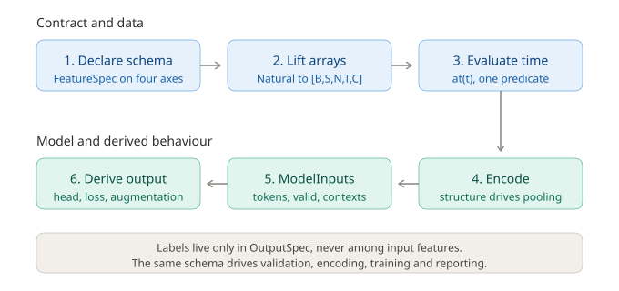

# Feature framework design

This is the conceptual guide to the unified input framework. If you want the
exact array shapes and error messages, see [Supplying inputs](inputs.md); for
the declaration reference see [Unified feature contracts](feature-schema.md).



## The one-sentence idea

A benchmark track is declared once as a `FeatureSchema`; that single object
drives validation, encoding, model construction, loss selection and reporting.
You never edit a model signature or a runner to add a feature.

## Why a framework at all

Before this layer, each of the seven data tracks hard-coded its own tensor
shape in an adapter, a doc table and a model signature. Adding a feature meant
touching all three, and nothing checked that they agreed. The framework makes
the declaration executable: one object owns the shapes, the timing rule and
the output semantics, and every downstream component reads from it.

The design has a deliberate split:

- **Contract layer** (`gamematch.features.schema`) is pure Python plus optional
  NumPy. It works on a base install with no PyTorch.
- **Trainable bridge** (`gamematch.features.torch_bridge`) needs the `neural`
  extra and is imported lazily, so `import gamematch.features` stays light.

## The axes

A `FeatureSpec` places one field on four independent axes:

| Axis | Values | Question it answers |
| --- | --- | --- |
| `modality` | `COEFFICIENT`, `DENSE`, `SEQUENCE` | Is this a vocabulary of IDs, a fixed vector, or a masked time series? |
| `scope` | `MATCH`, `TEAM`, `PLAYER` | Does this belong to the whole match, one side, or one player? |
| sides | `schema.sides = 1 or 2` | Is there a left/right axis at all? |
| `structure` | `SET`, `ORDERED`, `SINGLE` | Are the members exchangeable, ordered, or a single entity? |

`structure` is the semantic axis. It is inferred when omitted:
`MATCH → SINGLE`, `TEAM → ORDERED`, `PLAYER → SET`. Unlike a comment, it has
behaviour: `SET` uses permutation-invariant pooling, `ORDERED` adds learnable
slot embeddings on the time axis, and `SINGLE` needs no pooling.

One more declaration lives on the output side: `OutputSpec.orientation` says
what happens when the two sides swap. `ANTISYMMETRIC` (win/loss, WDL) gives a
side-sensitive context; `SYMMETRIC` and `NONE` use an invariant mean. This is
what makes side-swap augmentation legal rather than a source of contradictory
training pairs.

## One canonical layout

Every field is lifted to `[B, S, N, T, C]` — batch, sides, players per side,
time steps, channels. Non-applicable axes collapse to 1. `B` is the only shape
constant you ever pass; the rest comes from the schema.

The lift is not cosmetic. It is what lets a single validator check every
track, a single encoder apply every modality, and a single model consume the
result. A mask has the field's natural shape minus its channel axis and is
lifted to `[B,S,N,T]` by the same rules, which is why `MATCH × SEQUENCE` works
even though its natural mask is just `[B,T]`.

## The flow, stage by stage

1. **Declare.** Write `FeatureSpec(...)` objects and one `OutputSpec`. The
   built-in schemas in `SCHEMAS` are examples you can copy.
2. **Lift.** `FeatureBatch.from_natural(schema, **arrays)` turns natural-shaped
   arrays into the canonical layout. Use `sample_inputs(schema)` to get a valid
   batch without any data — useful for smoke tests and tutorials.
3. **Evaluate time.** `schema.at(prediction_time, available_at)` returns a
   `SchemaView`: the fields observable at that moment plus a report of what was
   excluded. See the next section — this is the only availability rule.
4. **Encode.** `SchemaEncoder` (trainable) or `FeatureEncoder` (deterministic
   NumPy reference) turns the visible fields into token embeddings. Both use
   the same visibility rule, so they cannot disagree about inputs.
5. **Model inputs.** Both encoders return `ModelInputs` with `tokens [B,S,N,D]`,
   `valid [B,S,N]`, `match_context` and `team_context`. This is the single
   interface downstream code sees.
6. **Derive.** `SchemaModel` builds the head from `OutputSpec`, and
   `model.criterion()` / `model.targets()` derive the loss and target shape.
   `model.augmented_batch()` applies side-swap with the correct label change.

## Time is one predicate, not a tag

There is no `PRE_MATCH` / `POST_MATCH` field type. "Post-game" describes when
you predict, not what a field is. The rule is:

```
available_at < prediction_time      (strict; equality is a leak)
```

`at(t)` shares its key resolution, scalar broadcasting, row alignment and mask
handling with `FeatureBatch.validate()`. Both accept a timestamp keyed by the
spec's `available_at` name or by the feature name. Observed steps only are
checked; masked padding is ignored. A scalar prediction time applies to every
row. Keeping one implementation is what prevents "validation passed but the
model silently dropped an input".

Consequences worth remembering:

- A post-game forecast (Dota future rating) uses a later prediction time and
  keeps its snapshot inputs. They are legal inputs at that time.
- `available_at=None` means no temporal constraint, not "untrusted".
- Labels are declared by `OutputSpec` and never appear in `features`.
- `predictor_schema(schema)` is a compatibility alias; with no argument it
  keeps every field. Pass a prediction time to get the same evaluation as `at`.

## What is derived rather than hand-coded

| Declaration | Derived behaviour |
| --- | --- |
| `FeatureSpec.structure` | Pooling mode; learnable slot embeddings for ordered sequences |
| `OutputSpec.kind`, `link`, `dim` | Output head width and activation |
| `OutputSpec.criterion()` | Loss (`BCEWithLogits`, `CrossEntropy`, `MSE`) |
| `OutputSpec.orientation` | Signed side pooling, bias-free head where provable, side-swap label rule |
| `schema.at(t)` | Which fields reach either encoder |
| `FeatureSchema` itself | Sample batches, validation report, CLI output, JSON round-trip |

The point is not fewer lines of declaration. It is that a declaration cannot
be silently ignored: either a component consumes it, or construction rejects
it. Reductions that were declared but never implemented (`max`, `last`) are
now rejected at construction rather than quietly behaving as `sum`.

## Adding a track

1. Write a `FeatureSchema` with your fields and one `OutputSpec`. Add it to
   `SCHEMAS` if it should be discoverable by CLI and catalog.
2. Call `sample_inputs(schema)` and `batch.validate()` to check the contract.
3. Build `model = make_model_from_schema(schema)`; train with
   `model.criterion()` and `model.targets(batch)`.
4. Replace `sample_inputs` with `FeatureBatch.from_natural(schema, ...)` once
   your real loader exists, passing `prediction_time` and `available_at` for
   any timed field.
5. Run `examples/schema_model.py --profile <name>` for an end-to-end smoke
   test with no dataset.

A full training loop lives in `examples/schema_model.py`.

## Where the input layer and the decision layer disagree

This is the most important boundary to understand before adding a track.

The **decision layer is more general than the input layer**:

- `matching/constraints.py::constrained_assignments` accepts two *unequal*
  team sizes, ordered role slots per side (repeated role names mark
  interchangeable slots) and party constraints.
- `exchangeable_sides` is only permitted for equal sizes with identical slot
  layouts, and the solver explicitly rejects it otherwise.
- `matching/search.py` streams candidates with time / candidate budgets, so
  the scorer is called on batches of feasible assignments rather than on a
  fixed roster tensor.

The **input layer is rigid by comparison**: `FeatureSchema.sides` and
`players` are single integers, so the canonical `[B,S,N,T,C]` gives every
side the same `N`. Unequal teams currently fit by **padding to a common N**
and relying on masks; role slots are not passed into a feature batch; and
`Orientation.ANTISYMMETRIC` assumes exactly two exchangeable sides, so it is
not meaningful for an unequal or multi-team assignment.

The gap is now **declared rather than assumed**: `FeatureSchema.players_per_side`
records real participant counts per side, and `exchangeable_sides` is true only
for two equal-sized sides. Unequal or multi-team layouts disable signed side
pooling, bias-free heads and `swap_sides`, and padded slots never enter pooling
or vocabulary checks.

Practical consequences:

- Padding is not a participant: `validate_ids()` ignores the padding value
  and any masked-out slot when checking a declared vocabulary, so a 3v5 lobby
  padded to five slots per side does not consume five hero IDs.
- Do not enable side-swap augmentation for unequal teams; the decision layer
  already forbids it for the same reason.
- A future input-layer upgrade would replace the scalar `players` with a
  per-side tuple and let `N` be a padded maximum with masks. That is a schema
  change, not a configuration option.

## Current limits

- The existing benchmark runners still consume their native tensors. They have
  not been switched to `SchemaModel`; migrating a track should be done with a
  regression comparison, one track at a time.
- Only reductions implemented by both encoders are accepted. Custom
  aggregations need a new modality or encoder change.
- An `assignment` output has no canonical loss; supply an objective explicitly
  through the matching API. `model.criterion()` raises for that kind.
- Synthetic decision intervals remain exploratory marginal intervals: oracle
  regret and training labels come from the same hidden generator.
- Table widths in `SCHEMAS` mirror the current adapters (5/13 history channels,
  114 heroes). Changing an adapter requires updating its spec.
